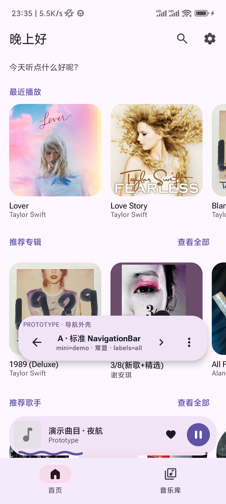
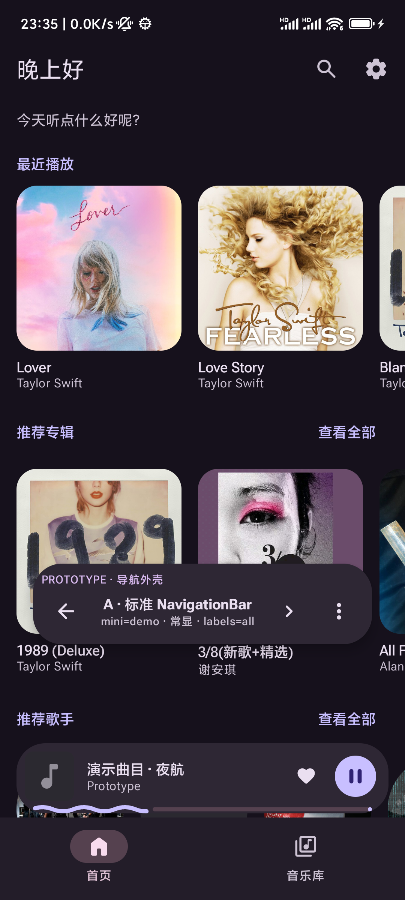
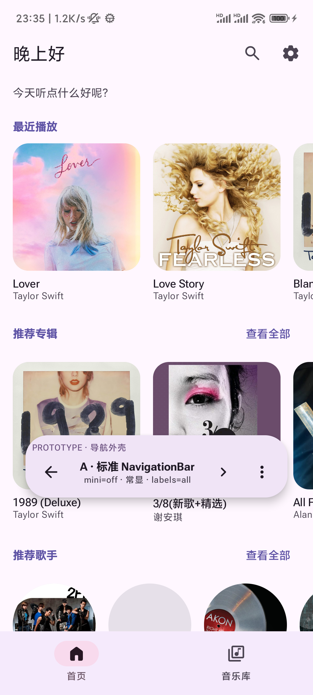
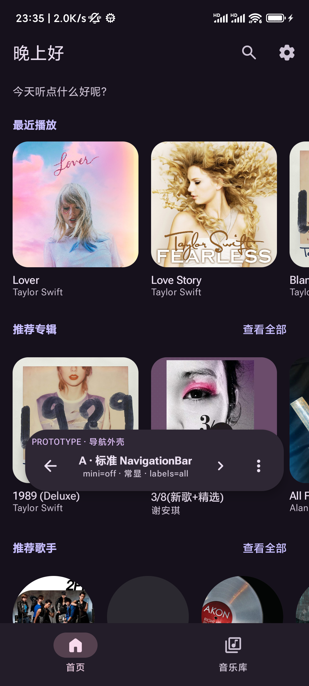

# 导航、底栏与播放器外壳

> 状态：**已决定**（2026-10-17）· 关联 [Sonic#5](https://github.com/mariamjensen42-glitch/Sonic/issues/5) · 落地票 #17
>
> **决策：保留标准 `NavigationBar`（原型变体 A）。** 不换 `ShortNavigationBar`，不引入 FAB。
>
> **落地状态（2026-10-17）**：#17 已保留 A、把迷你播放器留白搬进正式路径、删除 live prototype、
> 修正 `M3BottomNavigationBar` 注释；build/lint 与最终明暗复核待用户执行。原型源码快照见
> `docs/design/prototypes/navigation-shell/`。

## 问题

底部导航继续用标准 `NavigationBar`，还是换成 Expressive 的 `ShortNavigationBar` /
`FlexibleBottomAppBar` + FAB？需要同时容纳「首页 / 音乐库」两级 IA、迷你播放器、edge-to-edge
与内容留白。

## 决策

选 **A：标准 `NavigationBar` + `NavigationBarItem`**。保持现在的等宽、标签常显、官方指示器胶囊；
迷你播放器继续作为悬浮卡片叠在底栏上方；不引入 FAB。主壳转场保持现状（tab 淡入淡出、详情横推），
转场语法仍归 #7。

## 为什么

1. **只有两个顶级 destination，标签本身就是 IA。** 首页 / 音乐库不是两个可以靠图标猜出来的动作；
   A 的标签常显、位置稳定、等宽命中区，最符合这个信息架构。
2. **B 的“未选中只留图标”不是组件默认行为。** material3 1.5.0-alpha29 的
   `ShortNavigationBar` 只要 `label != null` 就常显标签；要做到选中才展开文字，必须手动对未选中项
   传 `label = null`，等于自己维护一套标签显隐规则。只有两个 tab 时，隐藏未选中标签牺牲的是
   可发现性，换来的只是更短的底栏。
3. **C 把 IA 变成了底栏里的分段控件，并且 FAB 只在首页出现。** 分段控件让“首页/音乐库”看起来像
   一个筛选器；FAB menu 和迷你播放器抢右下角，菜单展开时会压住迷你播放器；而且没有一个明确的、
   全应用适用的主操作。它比 A 更吵，不是更 Expressive。
4. **A 是零新组件风险的方案。** 不引入新的标签显隐逻辑、不改变 Navigation 3 的 backstack 语义、
   不新增 FAB 状态与菜单层级，也不推翻现有截图/验收基线。

## A 保留什么

- 标准 `NavigationBar` + `NavigationBarItem`，标签常显，选中态用官方指示器胶囊。
- 迷你播放器仍是悬浮卡片，位于底栏上方；波浪进度在卡片底部。
- 无 FAB；搜索、设置、创建歌单继续留在各屏顶栏。
- tab 切换淡入淡出；详情推入横推；player 从底部上推。转场语法归 #7，本次不比较。
- 非 tab 路由仍由 `NavigationState.recomputeBottomBarVisibility()` 自动隐藏底栏。
- tab 内部的全屏子视图（「音乐库 → 我喜欢」）用 `NavigationState.requestBottomBarHidden()` 收起底栏：
  子视图不是一条路由，导航层看不出它和 tab 根的区别，所以由页面在进入/退出时置位，并在
  `onDispose` 里复位（底栏藏着的时候用户无法切 tab，留成 `true` 就再也回不来了）。
- edge-to-edge：底栏吃导航栏 inset；内容由屏内 `Scaffold` + 底部留白处理。

## #17 落地时必须做

1. **底部留白修好。** 迷你播放器可见时，Home / 音乐库的列表底部要加
   `SonLayout.miniPlayerClearance`。现在生产路径只加了 `bottomBarClearance`（96dp），
   迷你播放器会盖住最后一行；原型路径已经通过 `AppNavGraph(bottomContentPadding = ...)` 验证了
   叠加后的留白。落地时把这条从原型路径搬进正式路径。
2. **保留 A，删掉抛弃式代码。** 删除 `presentation/.../navigation/prototype/`、`MainActivity` 里的
   debug 分支、`MiniPlayerContainer.ATTACHED`（只有 C 用到）、`scripts/capture-nav-shell-prototype.ps1`。
3. **修正 `M3BottomNavigationBar` 的注释。** 现有注释说 `ShortNavigationBar` 是“选中项展开、
   其余只留图标”的形态；alpha29 的实际行为是只要 `label != null` 就常显。A 的选择理由应改成
   “两级 IA 需要标签常显 + 稳定的等宽位置”，不是那条不准确的组件描述。
4. **过验收。** 明暗两套 + 滚到底部的截图；`./gradlew build` / `lint` 通过；#17 的验收清单。

## 被否掉的方案

### B — `ShortNavigationBar` 悬浮容器

- 形态：64dp 高、悬浮圆角容器、选中项展开图标+文字、未选中只留图标（可切“全部标签”）。
- 否决理由：标签显隐要手写；只有两个 tab 时隐藏标签降低可发现性；悬浮容器和迷你播放器叠在一起，
  视觉层级比 A 更复杂。
- 试跑备注：在 Android Studio **Apply Changes overlay** 里，B 的底栏只渲染了一个 item；当时不是完整
  `installDebug`，所以这个异常不作为 B 被否掉的主要理由，也没有继续追。主要理由仍是上面的
  标签/自定义成本。B 的截图保留为被否方案参考，不进入 A 的证据。

### C — `FlexibleBottomAppBar` + FAB

- 形态：底栏内放「首页/音乐库」分段控件；迷你播放器贴附在底栏上；仅首页出现 FAB menu
  （AI 创建歌单 / 随机播放 / 扫描）。
- 否决理由：分段控件把两级 IA 筛选器化；FAB 只在首页出现让底栏行为不一致；FAB menu 与迷你播放器
  抢右下角，菜单展开时压住播放器；没有明确的全应用主操作。
- 截图保留为被否方案参考；部分截图在 Home loading 时拍摄，仅看形态，不当内容证据。

## 证据

选中方案 A：

- 
- 
- 
- 
- 滚到底部（内容不被迷你播放器盖住）：
  [light](screens/nav-shell/a-light-mini-on-bottom.png) ·
  [dark](screens/nav-shell/a-dark-mini-on-bottom.png)

截图里的底部悬浮条是**原型调试条**，不是被评估的设计。

原型源码快照（live package 已由 #17 删除，不参与编译）：

- `docs/design/prototypes/navigation-shell/PrototypeNavigationShell.kt`
- `docs/design/prototypes/navigation-shell/README.md`
- `docs/design/prototypes/navigation-shell/capture-nav-shell-prototype.ps1`

## 验收

- [x] 选定方案能同时容纳底部 tab 与迷你播放器；没有采用 FAB，所以没有 FAB 遮挡问题。
- [x] 明暗两套都能读。
- [x] 滚到底部时最后一行停在迷你播放器之上（A 的正式路径；截图来自原型路径的同一留白逻辑）。
- [x] 非 tab 路由自动隐藏底栏。
- [x] tab 内部的全屏子视图（「我喜欢」）收起底栏，退出子视图后底栏回来。
- [ ] #17 完整构建 / lint 后复核（原型代码已删）。

## 后续

- #17 已按本文落地：保留 A、补底部留白、删 live prototype、更新 `M3BottomNavigationBar` 注释；待 build/lint + 明暗复核。
- 原型全套（A/B/C + 调试条）已快照到 `docs/design/prototypes/navigation-shell/`，live package 已删除；
  需要时再把快照切到 `prototype/navigation-shell` throwaway 分支，不混进 main。
